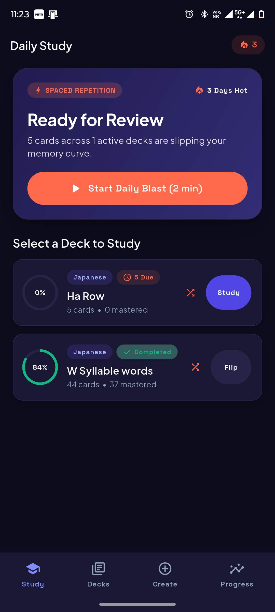
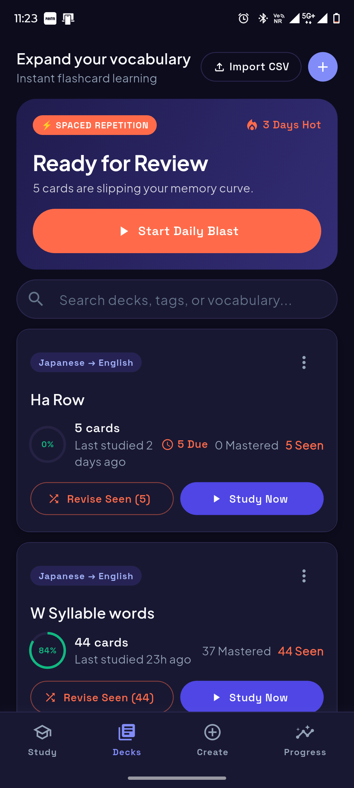
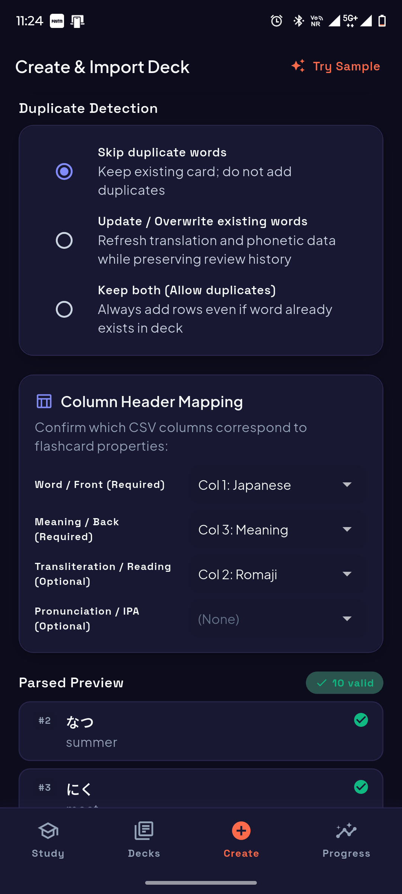
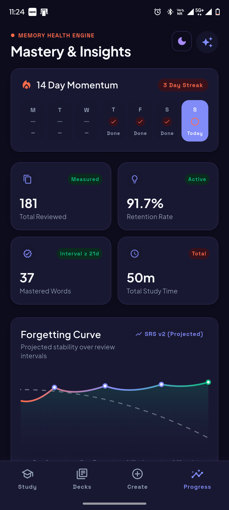

<p align="center">
  
</p>

<h1 align="center">Haki</h1>

<p align="center">
  <strong>A polished, animation-rich, local-first spaced repetition flashcard app built with Flutter.</strong>
</p>

<p align="center">
  <a href="https://github.com/shubhra-p/haki/releases"></a>
  <a href="https://flutter.dev"></a>
  <a href="https://dart.dev"></a>
  <a href="https://drift.simonbinder.eu"></a>
  <a href="#license"></a>
  <a href="https://github.com/shubhra-p/haki/releases"></a>
</p>

<p align="center">
  <a href="#-download--installation"><strong>Download App</strong></a> •
  <a href="#-key-features"><strong>Key Features</strong></a> •
  <a href="#-the-sm-2-spaced-repetition-engine"><strong>Spaced Repetition</strong></a> •
  <a href="#-csv-import-specification"><strong>CSV Engine</strong></a> •
  <a href="#-getting-started--build-from-source"><strong>Build from Source</strong></a> •
  <a href="docs/PROJECT_CONTEXT.md"><strong>Documentation</strong></a>
</p>

---

<p align="center">
  
</p>

---

## 🌟 Overview

Most flashcard tools are clunky, stuck in 2005 aesthetics, demand cloud accounts, or turn simple vocabulary imports into a chore.

**Haki** reimagines language acquisition from the ground up:
- **Instant Ingestion:** Import hundreds of cards from CSV files in seconds with smart header detection and duplicate resolution.
- **Sensory Study Experience:** Physical 3D card flips with real-world drag physics, directional aura glows, and tactile SM-2 grading.
- **Language-First Design:** Full support for non-Latin scripts (Japanese Kanji, Kana, Cyrillic, Chinese, Arabic) and reading placement toggles for character recognition.
- **100% Offline & Private:** Built on SQLite (`Drift`). Your cards, study streaks, and learning statistics never leave your device.

---

## 📥 Download & Installation

The latest pre-built production version of **Haki** is available in the **[Releases](https://github.com/shubhra-p/haki/releases)** section.

<p align="center">
  <a href="https://github.com/shubhra-p/haki/releases/latest">
    
  </a>
</p>

### Installing on Android
1. Go to the **[Latest Release](https://github.com/shubhra-p/haki/releases/latest)** page.
2. Under **Assets**, download the `app-release.apk` file.
3. Open the downloaded file on your Android device.
4. If prompted, allow installation from *Unknown Sources* in your system settings.
5. Tap **Install**, launch Haki, and start mastering your vocabulary!

---

## ✨ Key Features

### Tactile 3D Study Stage
- **True 3D Perspective Card Physics:** Realistic perspective card flips that respond naturally to gestures with angular drag resistance.
- **Directional Aura Glow:** Subtle visual feedback around cards during reviews (emerald glow for mastered items, rose tint for retry).
- **Four-Tier SM-2 Rating Controls:** Clearly labeled, high-contrast action buttons (*Again*, *Hard*, *Good*, *Easy*) showing projected SRS intervals.

### Frictionless CSV Ingestion & Duplicate Handling
- **Smart Column Detection:** Automatic alias matching for `word`, `meaning`, `transliteration`, and `pronunciation`.
- **Bulletproof Parsing:** Full RFC 4180 compliance, handles UTF-8 BOM, multiline cells, quotes, and non-Latin characters (Kanji, Kana, Cyrillic, etc.).
- **Duplicate Resolution Strategies:**
  - `Skip`: Retain existing card and discard new duplicate.
  - `Replace`: Update definition and pronunciations **while preserving existing SRS review history & interval**.
  - `Keep Both`: Import duplicate cards as independent entries.

### Kanji & Character Recognition (Reading Placement Toggle)
- Practice reading non-Latin scripts without spoilers!
- **Front vs. Back Readings:** Choose whether pronunciation and transliteration appear on the front or are hidden until you flip the card.
- Easily toggle reading placement per-deck or on-the-fly directly inside the study session header.

### Randomized Revision Mode
- Want to warm up or drill cards before a test without affecting your spaced repetition schedule?
- Practice all seen cards in randomized order at any time without resetting or shifting your SM-2 due dates.

### Local Memory Health & Retention Engine
- **14-Day Momentum Calendar:** Track daily study volume and active retention streaks.
- **4-Metric Health Grid:** Real-time visibility into Retention Rate, Total Cards, Learning Pace, and Mastered Cards.
- **Projected Forgetting Curve:** Interactive curve chart visualizing Ebbinghaus memory retention across interval milestones.

### Dynamic Light & Dark Themes
- High-contrast typography powered by **Plus Jakarta Sans** and **Space Grotesk** with comprehensive CJK fallback fonts.
- Rich, battery-saving dark mode with customized elevation tokens, warm card surfaces, and accessible contrast ratios.

### Local-First & Private
- Zero analytics, zero ads, zero accounts required.
- Backed by strongly typed SQLite schemas via **Drift**.
- Export any deck back to standard RFC 4180 CSV with one tap via native device share sheets.

---

## 📸 Screenshots & Showcase
<p align="center">
  
  
  
  
</p>

---

## 🧠 The SM-2 Spaced Repetition Engine

Haki implements a modern, deterministic variant of the **SuperMemo SM-2** spaced repetition algorithm:

| Rating | Interval Scaling | Ease Factor (EF) Impact | Description |
|---|---|---|---|
| **Again** | Resets to `0 days` (1 min) | $-0.20$ | Card lapsed. Re-queued immediately into the current session. |
| **Hard** | $\times 1.2$ | $-0.15$ | Card recalled with hesitation. Shorter interval increase. |
| **Good** | $\times \text{EF}$ | Unchanged | Optimal recall. Standard interval graduation. |
| **Easy** | $\times (\text{EF} \times 1.3)$ | $+0.15$ | Instant recall. Accelerated graduation boost. |

*Cards transition to **Mastered** status once their consecutive retention interval reaches $\ge 21$ days.*

---

## 📄 CSV Import Specification

Haki uses a clean **4-field card contract**. When importing a CSV file, headers are automatically detected using common aliases:

| Field | Required? | Accepted Header Aliases | Example Value |
|---|---|---|---|
| **Word** | Required | `word`, `term`, `vocabulary`, `vocab`, `front`, `target`, `question` | `約束` / `aprender` |
| **Meaning** | Required | `meaning`, `definition`, `translation`, `back`, `answer`, `english` | `promise; appointment` / `to learn` |
| **Transliteration** | Optional | `transliteration`, `romanization`, `romaji`, `pinyin`, `reading` | `yakusoku` |
| **Pronunciation** | Optional | `pronunciation`, `ipa`, `phonetic`, `sound` | `/ja.kɯ.so.kɯ/` |

### Sample CSV Snippet
```csv
word,meaning,transliteration,pronunciation
約束,promise; appointment,yakusoku,/ja.kɯ.so.kɯ/
木漏れ日,sunlight filtering through trees,komorebi,/ko.mo.ɾe.bi/
猫,cat,neko,/ne.ko/
```

> [!TIP]
> Bundled sample CSV datasets are available in [`assets/samples/`](assets/samples/) (`japanese_jlpt_n4.csv` and `spanish_conversational.csv`) to test out imports immediately.

---

## 🛠️ Architecture & Tech Stack

```
lib/
├── core/
│   ├── database/          # Drift SQLite tables, typed DAOs (Deck, Card, Review), migrations
│   ├── providers/         # Riverpod reactive state & query streams
│   ├── router/            # GoRouter navigation configuration & ShellRoute
│   └── theme/             # Design tokens, color schemes, typography & elevations
├── features/
│   ├── deck_library/      # Library view, search, deck stats rings, deck creation sheet
│   ├── deck_detail/       # Card lists, search, reading placement toggle, CSV export
│   ├── study/             # 3D study stage, gesture recognition, SM-2 ratings, revision mode
│   ├── csv_import/        # Dropzone, header auto-mapping, duplicate resolver, live preview
│   ├── card_editor/       # Fast "Save & Add Another" card creation
│   └── insights/          # 14-day momentum streak, memory retention grid & forgetting curve
├── models/                # Strongly-typed domain models (Deck, FlashCard, ReviewEvent)
└── services/              # Pure business logic: CsvParser, SpacedRepetitionScheduler, Analytics
```

| Component | Technology | Version | Purpose |
|---|---|---|---|
| **Framework** | Flutter SDK | `>=3.2.0 <4.0.0` | Cross-platform reactive client |
| **State Management** | `flutter_riverpod` | `^2.5.1` | Reactive dependency injection & stream providers |
| **Local Database** | `drift` + `sqlite3_flutter_libs` | `^2.16.0` | High-performance reactive SQLite ORM |
| **Routing** | `go_router` | `^14.2.0` | Declarative deep-linking & shell tabs |
| **Typography** | `google_fonts` | `^6.2.1` | Plus Jakarta Sans & Space Grotesk |
| **Charts** | `fl_chart` | `^0.68.0` | Ebbinghaus forgetting curve visualization |
| **CSV Engine** | `csv` + `file_picker` | `^6.0.0` / `^8.0.3` | RFC 4180 parsing with multi-encoding support |
| **Code Generation** | `build_runner` + `drift_dev` | `^2.4.9` / `^2.16.0` | Type-safe database companion generation |

---

## 🚀 Getting Started / Build from Source

### Prerequisites
- **Flutter SDK:** Version `^3.2.0` or higher ([Install Guide](https://docs.flutter.dev/get-started/install))
- **Dart SDK:** Version `>=3.2.0 <4.0.0`
- Target platform tools (Android SDK / Xcode / Visual Studio Desktop C++ tools)

### Installation & Run

1. **Clone the repository:**
   ```bash
   git clone https://github.com/shubhra-p/haki.git
   cd haki
   ```

2. **Install Flutter dependencies:**
   ```bash
   flutter pub get
   ```

3. **Generate Drift SQLite models & DAOs:**
   ```bash
   dart run build_runner build --delete-conflicting-outputs
   ```

4. **Verify static analysis & run test suites:**
   ```bash
   flutter analyze
   flutter test
   ```

5. **Launch the application:**
   ```bash
   flutter run
   ```

---

## 🧪 Testing & Verification

Haki maintains a comprehensive automated testing suite covering database operations, SM-2 transitions, CSV edge cases, layout responsiveness, and dark mode toggles:

```bash
# Run all unit and widget tests
flutter test

# Run tests with detailed test names
flutter test -r expanded
```

---

## 🤝 Contributing

Contributions make the open-source community an amazing place to learn, inspire, and create! Any contributions you make are **greatly appreciated**.

1. Fork the Project
2. Create your Feature Branch (`git checkout -b feature/AmazingFeature`)
3. Commit your Changes (`git commit -m 'feat: Add some AmazingFeature'`)
4. Push to the Branch (`git push origin feature/AmazingFeature`)
5. Open a Pull Request

---

## 📄 License

Distributed under the **MIT License**. See `LICENSE` for more information.

---

<p align="center">
  Crafted with care for lifelong language learners.<br>
  If you find Haki helpful, please consider giving it a ⭐ on <a href="https://github.com/shubhra-p/haki">GitHub</a>!
</p>

